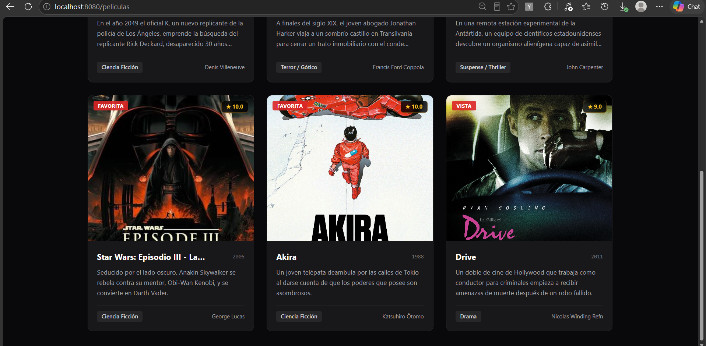
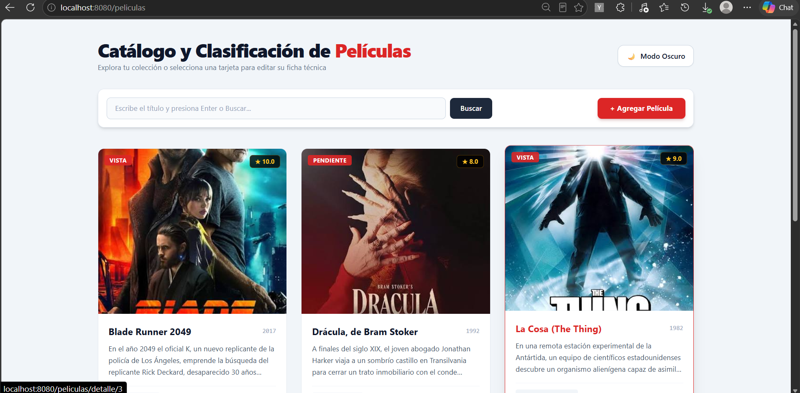
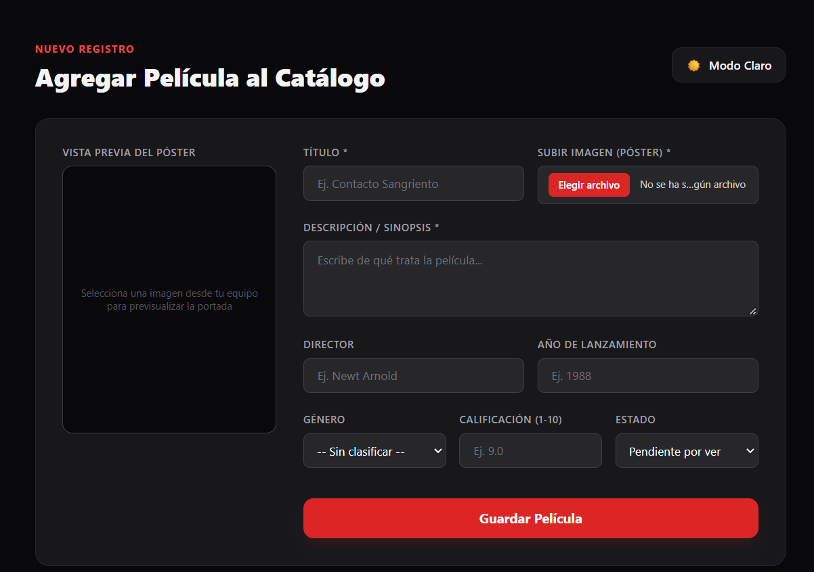
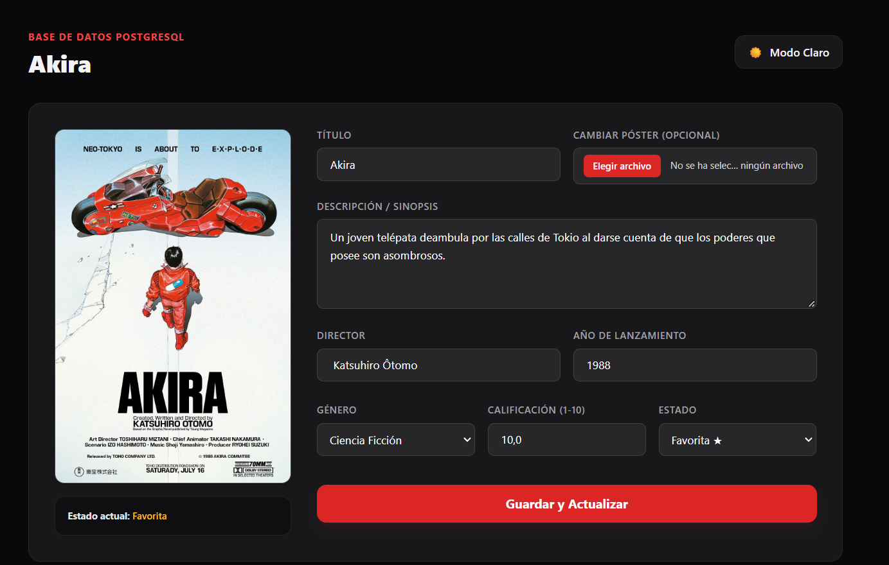

# 🎬 Catálogo y Clasificación de Películas

Aplicación web Full-Stack desarrollada con **Java Spring Boot**, **Thymeleaf**, **Tailwind CSS** y **PostgreSQL**. Permite gestionar una colección de películas, subir pósters locales desde el equipo, realizar búsquedas con temporizador (*debounce*) y clasificar cada título con su ficha técnica completa.

---

## ✨ Características Principales

* **Diseño en 3 Columnas (Responsive Grid):** Visualización limpia de tarjetas con póster, sinopsis resumida, año, calificación y estado de visualización.
* **Modo Claro / Oscuro Persistente:** Selector de tema visual integrado con Tailwind CSS y guardado automático en `localStorage`.
* **Buscador con Delay de 4 Segundos:** Barra de búsqueda por título que se activa al presionar `Enter` o hacer clic en `Buscar`, aplicando un retardo visual de 4 segundos antes de consultar la base de datos.
* **Subida de Imágenes Locales:** Carga de pósters mediante `MultipartFile` con almacenamiento local en el directorio `/uploads` y vista previa en tiempo real (`FileReader`).
* **Ficha Técnica y Clasificación:** Vista detallada para cada película que permite editar y actualizar director, año de lanzamiento, género, calificación (1-10) y estado (*Pendiente*, *Vista*, *Favorita*).

---

## 📸 Capturas de Pantalla

### 1. Página Principal (Modo Oscuro y Modo Claro)
Vista del catálogo en 3 columnas, buscador con indicador de espera y botón de cambio de tema.





### 2. Agregar Nueva Película
Formulario dedicado con subida de póster desde el ordenador y previsualización instantánea.



### 3. Ficha Técnica y Clasificación (Detalle)
Edición de metadatos almacenados en PostgreSQL y botón flotante de retorno (*Back*).



---

## 🛠️ Tecnologías Utilizadas

* **Backend:** Java 17/21, Spring Boot 3 (Spring Web, Spring Data JPA)
* **Frontend:** HTML5, Thymeleaf, Tailwind CSS (Play CDN), Vanilla JavaScript
* **Base de Datos:** PostgreSQL
* **Herramientas y Entorno:** IntelliJ IDEA, Maven, pgAdmin, Git & GitHub

---

## 📂 Estructura del Proyecto

```text
src/main/
├── java/com/ejemplo/peliculas/
│   ├── config/          # Exposición de la carpeta /uploads para imágenes locales
│   ├── controller/      # Rutas HTTP y manejo de archivos MultipartFile
│   ├── model/           # Entidad JPA Pelicula mapeada a PostgreSQL
│   ├── repository/      # Consultas con Spring Data JPA
│   └── service/         # Lógica de negocio
└── resources/
    ├── templates/       # Vistas Thymeleaf (index.html, nueva.html, detalle.html)
    └── application.properties